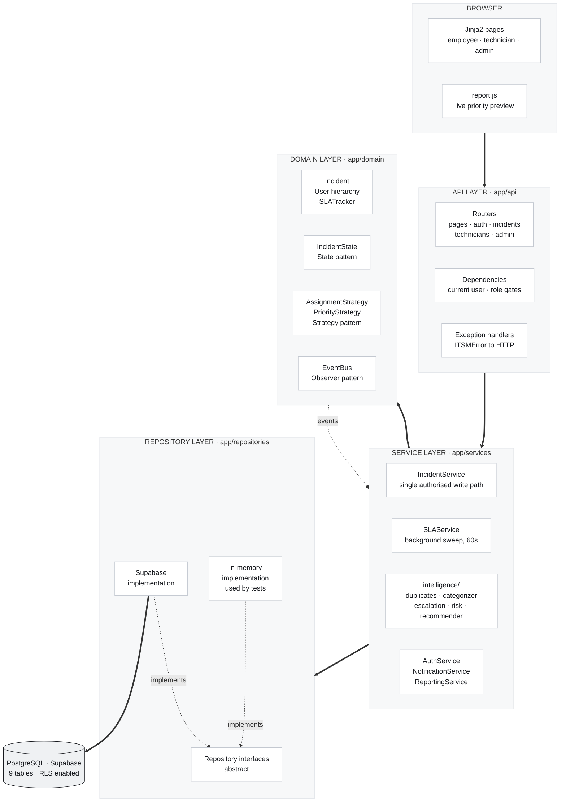

# System architecture

Layered. Each layer depends only on the one below it, and the dependency at the
bottom is on an interface rather than on Supabase, which is what lets the test
suite substitute an in-memory implementation.

## Why it is shaped this way

**Business logic sits in the domain and service layers.** The routers validate
input, call a service and render. The database holds data and constraints. The
two triggers that originally did technician assignment and SLA arithmetic in
plpgsql were dropped by migration 002, because logic in two engines drifts and
logic buried in plpgsql earns nothing on an object oriented rubric.

**The dependency at the bottom points at an interface.** `IncidentService` holds
a `Repository`, not a `SupabaseIncidentRepository`. That is why
`scripts/demo_server.py` can run the entire application with no database and why
all 71 tests run with no network.

**The SLA monitor has its own connection pool.** It runs on a worker thread every
60 seconds. Sharing one pool with request handling caused intermittent 503s,
because Supabase drops idle HTTP/2 connections and both sides kept picking up
sockets the other had abandoned.
