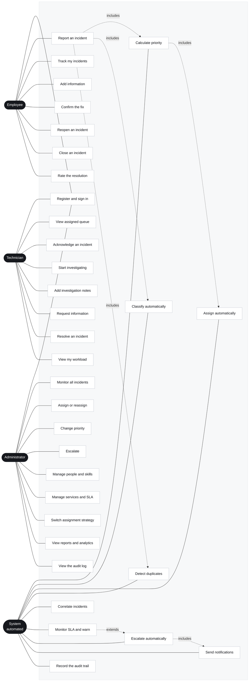

# Use case diagram

Three actors, plus the system itself, which is an actor here because seven
behaviours run without anybody asking.

## Notes

- **Register and sign in** is shared by all three human actors, which is why it
  appears once with three associations rather than three times.
- **Reporting an incident includes** priority calculation, automatic
  classification and duplicate detection. They are not optional steps a user can
  skip; they run as part of the use case.
- **SLA monitoring extends into escalation**: escalation only happens when the
  monitoring finds a deadline passed, so it is an extension rather than an
  inclusion.
- Authorisation is not drawn as use cases. It is enforced for every one of these
  by `User.require_action`, which consults the role and the state machine
  together.
