# Class diagram

Generated from the actual classes in `app/domain`, `app/repositories` and
`app/services`. Attributes are shown private where they are private in the code,
which is most of them.

```mermaid
classDiagram
    direction TB

    class User {
        <<abstract>>
        -UUID _id
        -str _employee_code
        -str _full_name
        -str _email
        -bool _is_active
        -str _password_hash
        +id() UUID
        +full_name() str
        +initials() str
        +role()* Role
        +home_route()* str
        +can_view(incident)* bool
        +available_actions(incident)* list~Action~
        +require_action(incident, key) Action
        +require_can_view(incident)
        +activate()
        +deactivate()
    }

    class Employee {
        +role() Role
        +home_route() str
        +can_view(incident) bool
        +available_actions(incident) list~Action~
        +view_refusal(incident) str
    }

    class Technician {
        -set~UUID~ _skills
        -int _max_workload
        -int _experience_level
        -int _active_workload
        +has_capacity() bool
        +load_fraction() float
        +spare_capacity() int
        +knows(category_id) bool
        +is_available_for(incident) bool
        +set_active_workload(count)
        +available_actions(incident) list~Action~
    }

    class Administrator {
        +can_manage_catalog() bool
        +can_view_audit_log() bool
        +available_actions(incident) list~Action~
    }

    User <|-- Employee
    User <|-- Technician
    User <|-- Administrator

    class Incident {
        -UUID _id
        -UUID _reporter_id
        -str _title
        -Impact _impact
        -Urgency _urgency
        -int _affected_users_count
        -Priority _priority
        -float _priority_score
        -Status _status
        -IncidentState _state
        -SLATracker _sla
        -int _escalation_level
        -list~IncidentUpdate~ _updates
        +reference() str
        +transition_to(target, actor) IncidentUpdate
        +assign_to(technician_id, ...)
        +apply_priority(priority, score, policy)
        +classify(category)
        +acknowledge(actor_id) IncidentUpdate
        +start_work(actor_id) IncidentUpdate
        +resolve(notes, actor_id) IncidentUpdate
        +reopen(reason, actor_id) IncidentUpdate
        +verify(actor_id) IncidentUpdate
        +close(notes, actor_id) IncidentUpdate
        +add_note(message, actor_id) IncidentUpdate
        +escalate(level, reason) IncidentUpdate
        +record_feedback(rating, comment)
        +refresh_sla() bool
        +sla_state() SLAState
        +allowed_transitions() frozenset~Status~
    }

    class IncidentState {
        <<abstract>>
        +Status status
        +allowed_transitions()* frozenset~Status~
        +on_enter(incident)
        +permits(target) bool
        +hint() str
    }

    class OpenState
    class ClassifiedState
    class AssignedState
    class AcknowledgedState
    class InProgressState
    class PendingState
    class ResolvedState
    class VerifiedState
    class ClosedState

    IncidentState <|-- OpenState
    IncidentState <|-- ClassifiedState
    IncidentState <|-- AssignedState
    IncidentState <|-- AcknowledgedState
    IncidentState <|-- InProgressState
    IncidentState <|-- PendingState
    IncidentState <|-- ResolvedState
    IncidentState <|-- VerifiedState
    IncidentState <|-- ClosedState

    class SLATracker {
        -datetime _created_at
        -SLAPolicy _policy
        -datetime _resolution_deadline_at
        -bool _resolution_breached
        +recalculate(policy)
        +refresh_flags(...) bool
        +state(resolved_at, now) SLAState
        +elapsed_fraction(now) float
        +resolution_remaining(now) timedelta
        +escalation_due(status_is_open) bool
    }

    class ITService {
        +UUID id
        +str name
        +int business_criticality
        +bool is_active
    }

    class Category {
        +UUID id
        +str name
    }

    class SLAPolicy {
        +Priority priority
        +float response_hours
        +float resolution_hours
        +float escalation_hours
        +response_target() timedelta
        +describe() str
    }

    class IncidentUpdate {
        +UUID incident_id
        +UpdateType update_type
        +str message
        +str old_status
        +str new_status
        +datetime created_at
    }

    Incident *-- SLATracker : composition
    Incident o-- ITService : aggregation
    Incident o-- Category : aggregation
    Incident *-- "0..*" IncidentUpdate : composition
    SLATracker o-- SLAPolicy : aggregation
    Incident --> IncidentState : current state
    Technician o-- "0..*" Category : skills

    class AssignmentStrategy {
        <<abstract>>
        +str name
        +str label
        +select(incident, technicians) AssignmentDecision
        +available(incident, technicians) list
        -_rank(incident, candidates)* list
        +reason_for(incident, technician) str
    }

    class SkillBasedAssignment
    class LoadBalancedAssignment
    class RoundRobinAssignment
    class ExperienceBasedAssignment

    AssignmentStrategy <|-- SkillBasedAssignment
    AssignmentStrategy <|-- LoadBalancedAssignment
    AssignmentStrategy <|-- RoundRobinAssignment
    AssignmentStrategy <|-- ExperienceBasedAssignment

    class PriorityStrategy {
        <<abstract>>
        +calculate(impact, urgency, criticality, affected)* PriorityDecision
        +for_incident(incident) PriorityDecision
    }

    class WeightedPriorityStrategy
    class MatrixPriorityStrategy

    PriorityStrategy <|-- WeightedPriorityStrategy
    PriorityStrategy <|-- MatrixPriorityStrategy

    class Observer {
        <<abstract>>
        +handles(event_type) bool
        +notify(event)*
    }

    class EventBus {
        -list~Observer~ _observers
        +subscribe(observer)
        +unsubscribe(observer)
        +publish(event)
        +publish_many(events)
    }

    class NotificationObserver
    class AuditLogObserver

    Observer <|-- NotificationObserver
    Observer <|-- AuditLogObserver
    EventBus o-- "0..*" Observer : notifies

    class NotificationChannel {
        <<abstract>>
        +str name
        +send(user, title, message)* bool
        +available_for(user) bool
    }

    class InAppChannel
    class EmailChannel
    class SmsChannel

    NotificationChannel <|-- InAppChannel
    NotificationChannel <|-- EmailChannel
    NotificationChannel <|-- SmsChannel

    class NotificationService {
        -list~NotificationChannel~ _channels
        +channels_for(priority, event_type) list
        +dispatch(recipients, title, message) int
    }

    NotificationService *-- "1..*" NotificationChannel : composition
    NotificationObserver --> NotificationService

    class Repository~T~ {
        <<abstract>>
        +get(id)* T
        +add(entity)* T
        +update(entity)* T
    }

    class IncidentRepository {
        <<abstract>>
        +search(query)* list~Incident~
        +count(query)* int
        +active_workload()* dict
        +open_incidents()* list
    }

    class SupabaseIncidentRepository
    class InMemoryIncidentRepository

    Repository <|-- IncidentRepository
    IncidentRepository <|-- SupabaseIncidentRepository
    IncidentRepository <|-- InMemoryIncidentRepository

    class IncidentService {
        +report(...) tuple
        +assign(actor, incident_id, technician_id) Incident
        +perform(actor, incident_id, action_key) Incident
        +change_priority(actor, incident_id, priority) Incident
        +search_for(user, query) list
    }

    class IncidentFactory {
        -PriorityStrategy _priority_strategy
        +build(...) tuple~Incident, list~
    }

    class UserFactory {
        +create(role, **kwargs)$ User
    }

    IncidentService --> IncidentRepository : depends on the interface
    IncidentService --> AssignmentStrategy
    IncidentService --> EventBus
    IncidentService --> IncidentFactory
    IncidentFactory --> PriorityStrategy
    IncidentFactory ..> Incident : creates
    UserFactory ..> User : creates
```

## How to read it for the viva

| OOP requirement | Where it is in this diagram |
|---|---|
| **Inheritance** | `User` to `Employee`, `Technician`, `Administrator`. Used only where "is-a" holds and the subclasses differ in behaviour, not just data. |
| **Abstraction** | Six abstract classes: `User`, `IncidentState`, `AssignmentStrategy`, `PriorityStrategy`, `Observer`, `NotificationChannel`, plus `Repository`. |
| **Polymorphism** | `available_actions()` returns a different set per role. `calculate()` gives different priorities per strategy. `select()` picks a different technician per strategy. |
| **Encapsulation** | Every `Incident` attribute is private. Status changes only through `transition_to`, priority only through `apply_priority`, which also moves the SLA so the two cannot drift. |
| **Composition** | `Incident *-- SLATracker` and `Incident *-- IncidentUpdate`. Destroy the incident and both go with it. |
| **Aggregation** | `Incident o-- ITService` and `o-- Category`. The Payment Application service outlives any incident against it. |
| **Interfaces** | `Repository` has two implementations that the services cannot tell apart. That is what makes the test suite run with no database. |
