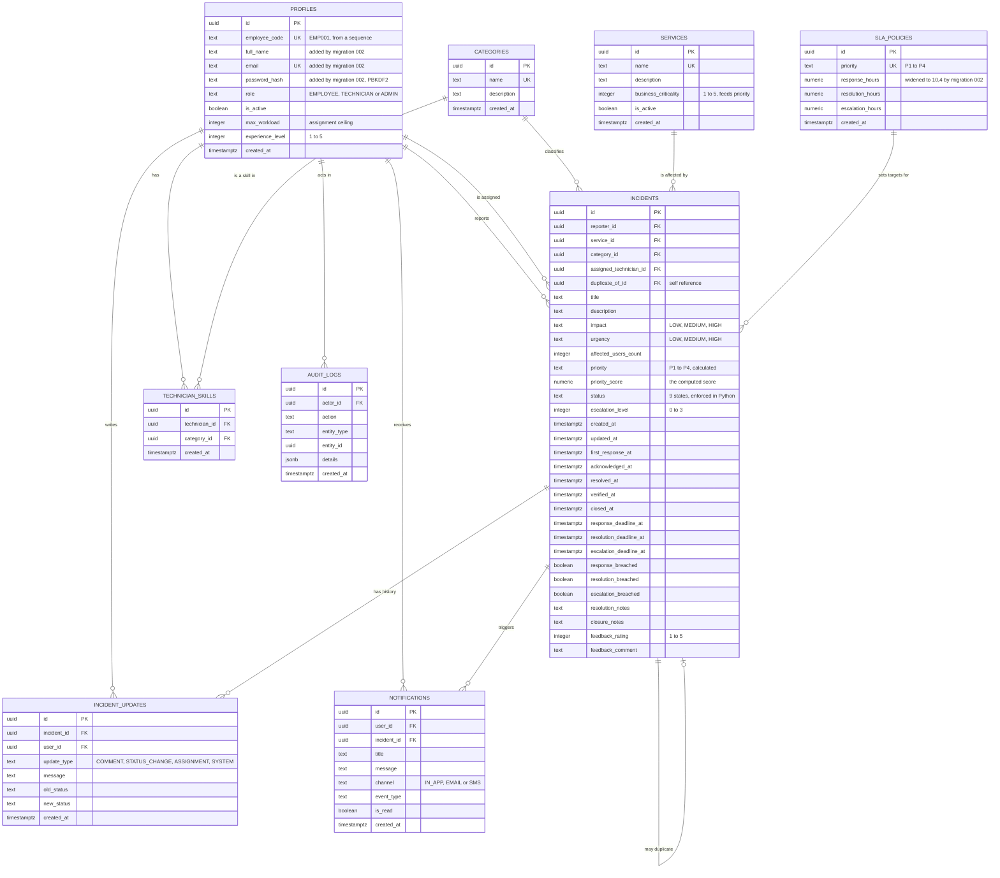

# Entity relationship diagram

Nine tables in PostgreSQL, as created by `schema.sql` and amended by
migration 002.

## Design notes

**`PROFILES` has two relationships to `INCIDENTS`.** One as reporter, one as
assigned technician. Both are foreign keys to the same table, which is why the
Supabase queries have to name the constraint explicitly
(`incidents!incidents_reporter_id_fkey`) rather than letting it infer the join.

**`SLA_POLICIES` relates to `INCIDENTS` through the priority value**, not a
foreign key. Priority is a four value domain, so the policy is looked up by it.
This keeps an incident's priority meaningful even if a policy row is edited.

**`INCIDENTS.duplicate_of_id` is a self reference**, nullable and
`ON DELETE SET NULL`. The duplicate detector writes it; nothing depends on it
being present.

**Three sets of timestamps are stored rather than derived.** The lifecycle
stamps (`acknowledged_at` through `closed_at`), the three deadlines, and the
three breach booleans. The deadlines could be computed from `created_at` plus
the policy, but storing them means a policy edit does not silently move the
deadline on an incident that was already running under the old one.

**Row level security is enabled on every table.** The backend connects with the
service role key and authorises in Python, where the object model can express
it; RLS remains as a second line in case anything else ever connects.

**Indexes** are on `incidents(created_at, status, priority, reporter_id,
assigned_technician_id, service_id)`, on `incident_updates(incident_id)`, on
`audit_logs(created_at)`, on `notifications(user_id)`, and a GIN trigram index
on `incidents(title)` for duplicate detection.
