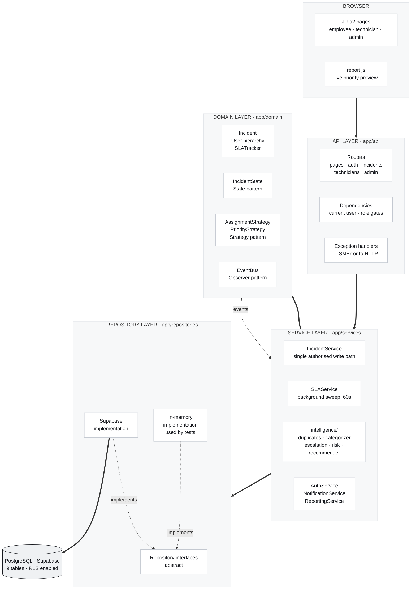
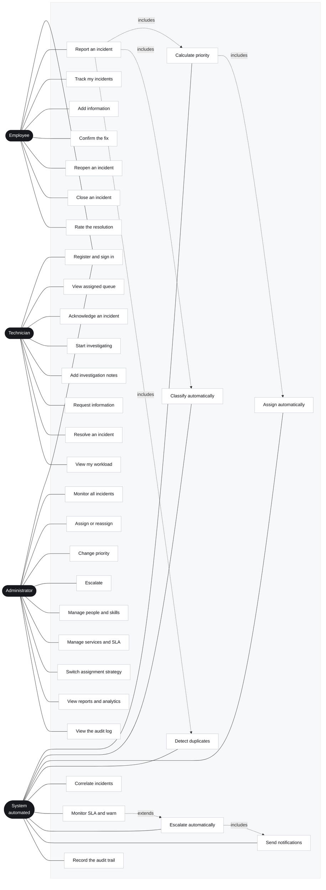
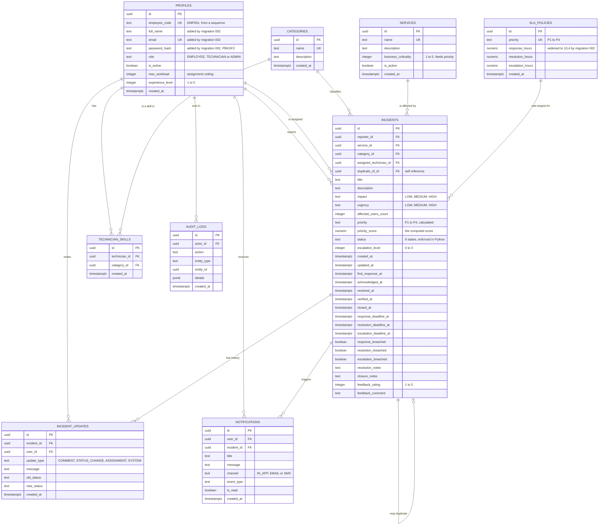

# Intelligent IT Service Management and Incident Resolution System

## I-ITSM

**CS F213 / MAC F212, Object Oriented Programming**
**Semester I, 2026 to 2027**
**BITS Pilani, Hyderabad Campus**

### Group 67

| Member | Area of responsibility |
|---|---|
| Amith | Domain model and OOP core, architecture, integration |
| Inian | API layer, authentication and authorisation, test suite |
| Anirudh | Interface, templates, three role views, design system |
| Lokith | Persistence, repositories, schema and migrations, reporting |
| Kartik | Intelligent and automated features, notifications, observers |

**Repository:** <https://github.com/kart1k1927/OOPS_PROJECT_67>

**Submitted:** 22 November 2026

---

## Contents

1. Problem Analysis
2. Requirements Specification
3. Technology Selection Report
4. Test Cases
5. System Architecture
6. UML Use Case Diagram
7. UML Class Diagram
8. Entity Relationship Diagram
9. Design System and User Experience

---

## Summary

I-ITSM manages the complete lifecycle of an IT incident, from report through
classification, prioritisation, assignment, investigation, resolution,
verification and closure.

| | |
|---|---|
| Lines of Python | ~8,300 |
| Templates, CSS and JavaScript | ~1,950 lines |
| Database | 9 tables, PostgreSQL on Supabase |
| Design patterns | 5: State, Strategy, Observer, Repository, Factory |
| Assignment strategies | 4, interchangeable at runtime |
| Priority algorithms | 2, interchangeable at runtime |
| Notification channels | 3, behind one abstraction |
| Intelligent features | 7, all rule based and explainable |
| Search criteria | 9, combinable |
| Documented test cases | 58, collected as 71 runs, all passing |
| Infrastructure needed to run the tests | None |


---

# 1. Problem Analysis

## 1.1 The problem

BITS Pilani Hyderabad Campus runs on IT services that most people only notice
when they stop. The payment portal, campus wifi, the employee portal, email,
lab machines, the library printers, licence servers. When one of them fails, the
person affected has no reliable way to report it and no way to find out what
happened next.

Today that reporting happens informally: a phone call to CCIT, a message to
somebody who knows somebody, an email that may or may not be read. The
consequences are predictable and all of them were listed in the project brief:

| Failure | What it looks like on campus |
|---|---|
| Delayed response | A reported fault sits unread because nobody owns the inbox |
| Incorrect prioritisation | A single broken printer gets attention before a payment outage affecting 120 people |
| Inefficient technician allocation | One technician has eleven open jobs while another has two |
| SLA violations | Nobody agreed what "urgent" means in hours, so nothing is ever late |
| Poor visibility | No one can answer "how many incidents are open right now" |
| Duplicate reports | Forty people report one wifi outage as forty separate problems |
| Incomplete history | The fix is in a technician's head, so the next occurrence starts from zero |
| Recurring problems unnoticed | The same service fails monthly and nobody connects the instances |

The underlying issue is not that people are careless. It is that **the
information needed to make good decisions is never in one place**. Priority
needs impact, urgency and how critical the service is. Assignment needs skills,
current workload and availability. None of that is recorded anywhere, so every
decision is made from memory and intuition.

## 1.2 Stakeholders

| Stakeholder | What they need | What they currently get |
|---|---|---|
| **Employee / student** | To report a fault in under a minute and then see what is happening to it | A phone call and silence |
| **Technician** | A prioritised queue, the context to start work, and a workload that is survivable | Whatever reaches them, in whatever order it arrives |
| **IT Manager / Administrator** | To see service health, spot overloaded technicians and know which SLAs are being missed | No numbers at all |
| **CCIT / Maintenance Division** | Evidence to justify staffing and infrastructure spending | Anecdote |
| **The campus** | Services that come back quickly | Variable |

## 1.3 Existing challenges

**Prioritisation is subjective.** "Urgent" means whatever the reporter says it
means. There is no agreed formula, so two identical incidents get different
treatment depending on who logs them and how insistent they are.

**Assignment is ad hoc.** Jobs go to whoever is nearest or most recently
mentioned, not to whoever is trained in that category and has capacity.

**Nothing is measured.** Without recorded timestamps there is no way to say
whether response times are improving, which services fail most, or whether a
technician is overloaded.

**Knowledge is not retained.** The same incident recurs and the resolution has
to be rediscovered, because last time's fix was never written down against the
incident.

**No audit trail.** When something goes wrong in handling a fault, there is no
record of who did what and when.

## 1.4 Proposed solution

**I-ITSM**, an Intelligent IT Service Management and Incident Resolution System:
a web application that manages the complete lifecycle of an IT incident from
report through classification, prioritisation, assignment, investigation,
resolution, verification and closure.

The system directly answers each challenge above:

| Challenge | How I-ITSM addresses it |
|---|---|
| Subjective prioritisation | A documented formula, `impact x urgency x business criticality`, with a bump for the number of people affected, shown live on the report form as the reporter types |
| Ad hoc assignment | Four assignment strategies, selectable at runtime, all of which respect skills, workload ceilings and availability |
| Nothing measured | Every incident carries SLA deadlines derived from its priority, monitored continuously, with an administrator dashboard reporting open counts, workload, service health and violations |
| Knowledge lost | Every resolution is recorded against its incident, and similar past resolutions are surfaced to the technician working a new one |
| No audit trail | Every state change is written automatically by an observer, so the trail cannot drift out of step with what happened |
| Duplicate reports | New reports are compared against recent ones on the same service, and possible duplicates are shown to the reporter before they submit |

The central academic question the brief asks is how object oriented thinking
produces a maintainable, extensible system. The answer this project gives is
that **each of the varying policies above is an object, not a branch in a
function**. Adding a fifth assignment strategy means writing a class. Adding a
tenth lifecycle state means writing a class. Neither requires editing existing
code, and that is the difference between a system that can be handed to CCIT and
one that cannot.

## 1.5 Assumptions

1. **Scale.** Designed for a campus: hundreds of users, tens of technicians,
   tens of incidents per day. Not for an enterprise handling thousands daily.
2. **Trust.** Users are campus members with real identities. The system defends
   against mistakes and casual misuse, not a determined attacker.
3. **Email and SMS are simulated.** The brief states this is acceptable. Both
   channels write a full envelope to `logs/outbox.log`, so switching to a real
   SMTP or Twilio adapter means writing one class.
4. **One organisation.** No multi tenancy, no inter departmental separation
   beyond roles.
5. **Technicians self report capacity.** `max_workload` is configured by an
   administrator rather than inferred.
6. **Business criticality is set by an administrator**, on a 1 to 5 scale, and
   is treated as given rather than derived from usage data.
7. **English only.** No localisation.
8. **Rule based intelligence.** The brief explicitly makes AI and ML optional
   and states that a well designed rule based system is acceptable. We chose
   rule based deliberately, because every decision the system makes can then be
   explained line by line, which matters more in an operations tool than raw
   accuracy.


---

# 2. Requirements Specification

## 2.1 User roles

| Role | Class | Lands on | Sees |
|---|---|---|---|
| Employee | `Employee` | `/my-incidents` | Only incidents they reported |
| Technician | `Technician` | `/queue` | Incidents assigned to them, plus unassigned ones |
| Administrator | `Administrator` | `/operations` | Everything |

Scoping is polymorphic, not conditional. `User.can_view()` is answered
differently by each subclass, and `IncidentService.search_for()` narrows the
query based on the type of the user it is given. Adding a Team Lead role means
adding a class.

## 2.2 Functional requirements

### FR-1 User management

| ID | Requirement | Where |
|---|---|---|
| FR-1.1 | A visitor can register as an employee with name, email and password | `AuthService.register` |
| FR-1.2 | Passwords are at least 8 characters and mix letters and numbers | `security.validate_password_strength` |
| FR-1.3 | A registered user can sign in and receives a session valid for 12 hours | `AuthService.authenticate` |
| FR-1.4 | An unknown email and a wrong password produce an identical message | `InvalidCredentialsError` |
| FR-1.5 | A deactivated account cannot sign in | `InactiveAccountError` |
| FR-1.6 | An administrator can change any user's role and activate or deactivate them | `/admin/people` |
| FR-1.7 | An administrator can set a technician's skills, capacity and experience | `/admin/people` |

### FR-2 Incident management

| ID | Requirement | Where |
|---|---|---|
| FR-2.1 | An employee can report an incident with title, description, service, category, impact, urgency and affected user count | `IncidentService.report` |
| FR-2.2 | A title must be 8 to 160 characters | `Incident._validated_title` |
| FR-2.3 | Affected users must be a whole number from 1 to 100000 | `Incident._validated_affected` |
| FR-2.4 | Every incident receives a unique reference of the form `INC-8F51D7` | `Incident.reference` |
| FR-2.5 | Any user can view an incident they are entitled to see | `User.can_view` |
| FR-2.6 | A technician can acknowledge, start, hold, resume and resolve an assigned incident | `Technician.available_actions` |
| FR-2.7 | A resolution must be at least 10 characters | `Incident.resolve` |
| FR-2.8 | A reporter can confirm a fix, reopen it, close it and rate it 1 to 5 | `Employee.available_actions` |
| FR-2.9 | Any entitled user can add a note to an open incident | `Incident.add_note` |
| FR-2.10 | An administrator can assign, reassign, change priority and escalate | `Administrator.available_actions` |

### FR-3 Classification and prioritisation

| ID | Requirement | Where |
|---|---|---|
| FR-3.1 | Incidents are classified into at least 9 categories | `categories` table |
| FR-3.2 | New categories can be added without changing code | `/admin/catalog` |
| FR-3.3 | Priority is calculated from impact, urgency, business criticality and affected users | `WeightedPriorityStrategy` |
| FR-3.4 | The calculation is shown to the reporter live, as they fill the form | `report.js` |
| FR-3.5 | At least two priority algorithms exist and are interchangeable | `WeightedPriorityStrategy`, `MatrixPriorityStrategy` |
| FR-3.6 | Priority maps to P1 Critical, P2 High, P3 Medium, P4 Low | `Priority` |
| FR-3.7 | Changing priority recalculates the SLA deadlines in the same operation | `Incident.apply_priority` |

### FR-4 Technician assignment

| ID | Requirement | Where |
|---|---|---|
| FR-4.1 | At least two assignment strategies exist | Four do |
| FR-4.2 | The active strategy can be changed at runtime without a restart | `/admin/settings` |
| FR-4.3 | No strategy assigns to an inactive technician | `AssignmentStrategy.available` |
| FR-4.4 | No strategy assigns past a technician's workload ceiling | `Technician.has_capacity` |
| FR-4.5 | If nobody is available the incident is still created, unassigned, with the reason recorded | `IncidentService.report` |
| FR-4.6 | An administrator can override the strategy and assign manually | `IncidentService.assign` |

### FR-5 SLA management

| ID | Requirement | Where |
|---|---|---|
| FR-5.1 | Each priority has response, resolution and escalation targets | `sla_policies` |
| FR-5.2 | Deadlines are derived from the policy when an incident is created | `SLATracker.recalculate` |
| FR-5.3 | SLA state is monitored continuously, not on demand | `SLAService.sweep`, every 60s |
| FR-5.4 | An incident past 75 percent of its window is flagged at risk and warned once | `AT_RISK_FRACTION` |
| FR-5.5 | An incident past its deadline is flagged breached and notified | `SLAService.sweep` |
| FR-5.6 | An administrator can trigger a sweep immediately | `/admin/sla/sweep` |
| FR-5.7 | SLA targets are editable by an administrator | `/admin/catalog` |

### FR-6 Lifecycle

| ID | Requirement | Where |
|---|---|---|
| FR-6.1 | The lifecycle is OPEN, CLASSIFIED, ASSIGNED, ACKNOWLEDGED, IN_PROGRESS, PENDING, RESOLVED, VERIFIED, CLOSED | `Status` |
| FR-6.2 | Illegal transitions are refused, OPEN to CLOSED specifically | `IncidentState.permits` |
| FR-6.3 | A refusal states what transitions are legal from here | `IncidentState.hint` |
| FR-6.4 | CLOSED is terminal | `ClosedState` |
| FR-6.5 | Entering a state stamps the relevant timestamp automatically | `IncidentState.on_enter` |

### FR-7 Notifications

| ID | Requirement | Where |
|---|---|---|
| FR-7.1 | At least two notification mechanisms exist | Three do: in-app, email, SMS |
| FR-7.2 | Notifications fire on created, assigned, acknowledged, priority changed, SLA approaching, SLA violated, escalated, resolved, verified, closed | `NotificationObserver.SUBSCRIBED` |
| FR-7.3 | Which channels run depends on priority | `NotificationService.channels_for` |
| FR-7.4 | A failed channel does not fail the operation | `NotificationService.dispatch` |
| FR-7.5 | The user who performed an action is not notified about it | `NotificationObserver._recipients` |
| FR-7.6 | Adding a channel requires no change to existing code | `NotificationChannel` |

### FR-8 Audit

| ID | Requirement | Where |
|---|---|---|
| FR-8.1 | Every incident keeps a complete history | `incident_updates` |
| FR-8.2 | Each entry records timestamp, user, action, incident, previous state, new state and description | `AuditLogObserver` |
| FR-8.3 | The trail is written by an observer, so it cannot drift from what happened | `EventBus.publish` |
| FR-8.4 | Only an administrator can read the full audit log | `Administrator.can_view_audit_log` |

### FR-9 Search and reporting

| ID | Requirement | Where |
|---|---|---|
| FR-9.1 | At least five search criteria. Nine exist and they combine | `IncidentQuery` |
| FR-9.2 | Criteria are free text, reference, status, priority, category, service, technician, SLA state and date range | `pages._query_from` |
| FR-9.3 | Four sort orders: priority, newest, recently updated, SLA deadline | `IncidentRepository.search` |
| FR-9.4 | The dashboard reports total, open, P1 open, resolved and SLA violations | `ReportingService.overview` |
| FR-9.5 | Technician workload, service analysis and category breakdown are reported | `ReportingService` |

### FR-10 Intelligent features

| ID | Requirement | Where |
|---|---|---|
| FR-10.1 | Duplicate detection on report, flagging rather than blocking | `DuplicateDetector.find` |
| FR-10.2 | Incident correlation by affected service | `DuplicateDetector.correlate` |
| FR-10.3 | Automatic categorization from the description | `IncidentCategorizer` |
| FR-10.4 | Automatic escalation through four tiers | `EscalationEngine` |
| FR-10.5 | SLA risk prediction with stated reasoning | `SLARiskDetector` |
| FR-10.6 | Technician recommendation with stated reasoning | `TechnicianRecommender` |
| FR-10.7 | Suggested resolutions from similar past incidents | `ResolutionRecommender` |

## 2.3 Non functional requirements

| ID | Requirement | How it is met |
|---|---|---|
| NFR-1 | **Maintainability.** Adding a strategy, state, role or channel must not require editing existing code | Abstract base classes with registries; verified by the fact that four assignment strategies share no code path |
| NFR-2 | **Testability.** The test suite must run without infrastructure | Repository pattern with an in-memory implementation; 71 tests, no database, no keys, no network |
| NFR-3 | **Security.** Passwords hashed, sessions signed, authorisation server side | PBKDF2-HMAC-SHA256 at 390,000 iterations; JWT in an HttpOnly cookie; `User.require_action` on every write |
| NFR-4 | **Usability.** A technician must see what to do next without reading documentation | The action panel shows only permitted actions, so there are no disabled buttons to interpret |
| NFR-5 | **Reliability.** A failure in a secondary concern must not lose primary work | Observers that raise are logged and skipped; audit write failures do not block sign in; transient database drops are retried |
| NFR-6 | **Performance.** Incident lists must render promptly at campus scale | Indexed on status, priority, reporter, assignee, service and created_at; a GIN trigram index supports duplicate detection |
| NFR-7 | **Auditability.** Every state change must be attributable | Observer driven audit log, 9 recorded event types |
| NFR-8 | **Accessibility.** Keyboard reachable, readable contrast | Visible focus ring on every interactive element; status conveyed by colour **and** a word, never colour alone |
| NFR-9 | **Portability.** Must run on any platform that runs a Python process | Dockerfile, Procfile and render.yaml, all using the same start command |

## 2.4 Business rules

| ID | Rule |
|---|---|
| BR-1 | An incident may only move between states the state machine permits. OPEN to CLOSED is refused. |
| BR-2 | CLOSED is final. There is no transition out of it. |
| BR-3 | Priority and SLA deadlines change together or not at all. |
| BR-4 | A technician at their workload ceiling is never assigned more work automatically. |
| BR-5 | An inactive technician is never assigned work. |
| BR-6 | An inactive service cannot have incidents reported against it. |
| BR-7 | A resolution requires at least 10 characters of explanation. |
| BR-8 | Feedback can only be given after an incident is resolved, and must be 1 to 5. |
| BR-9 | An employee may only view incidents they reported. |
| BR-10 | A technician may only act on incidents assigned to them. |
| BR-11 | A reporter may close an incident only after verifying the fix. |
| BR-12 | An incident with no SLA policy for its priority cannot be created. |
| BR-13 | An incident cannot be marked a duplicate of itself. |
| BR-14 | The person who performs an action is not notified about it. |
| BR-15 | Escalation widens who is informed. It never reassigns the incident. |


---

# 3. System Architecture


Layered. Each layer depends only on the one below it, and the dependency at the
bottom is on an interface rather than on Supabase, which is what lets the test
suite substitute an in-memory implementation.



## Why it is shaped this way

**Business logic sits in the domain and service layers.** The routers validate
input, call a service and render. The database holds data and constraints. The
two triggers that originally did technician assignment and SLA arithmetic in
plpgsql were dropped by migration 002, because logic in two engines drifts and
logic buried in plpgsql earns nothing on an object oriented rubric.

**The dependency at the bottom points at an interface.** `IncidentService` holds
a `Repository`, not a `SupabaseIncidentRepository`. That is why
`scripts/demo_server.py` can run the entire application with no database and why
all 71 tests run with no network.

**The SLA monitor has its own connection pool.** It runs on a worker thread every
60 seconds. Sharing one pool with request handling caused intermittent 503s,
because Supabase drops idle HTTP/2 connections and both sides kept picking up
sockets the other had abandoned.


---

# 4. UML Diagrams

## 4.1 Use case


Three actors, plus the system itself, which is an actor here because seven
behaviours run without anybody asking.



## Notes

- **Register and sign in** is shared by all three human actors, which is why it
  appears once with three associations rather than three times.
- **Reporting an incident includes** priority calculation, automatic
  classification and duplicate detection. They are not optional steps a user can
  skip; they run as part of the use case.
- **SLA monitoring extends into escalation**: escalation only happens when the
  monitoring finds a deadline passed, so it is an extension rather than an
  inclusion.
- Authorisation is not drawn as use cases. It is enforced for every one of these
  by `User.require_action`, which consults the role and the state machine
  together.


## 4.2 Class diagram


Generated from the actual classes in `app/domain`, `app/repositories` and
`app/services`. Attributes are shown private where they are private in the code,
which is most of them.

```mermaid
classDiagram
    direction TB

    class User {
        <<abstract>>
        -UUID _id
        -str _employee_code
        -str _full_name
        -str _email
        -bool _is_active
        -str _password_hash
        +id() UUID
        +full_name() str
        +initials() str
        +role()* Role
        +home_route()* str
        +can_view(incident)* bool
        +available_actions(incident)* list~Action~
        +require_action(incident, key) Action
        +require_can_view(incident)
        +activate()
        +deactivate()
    }

    class Employee {
        +role() Role
        +home_route() str
        +can_view(incident) bool
        +available_actions(incident) list~Action~
        +view_refusal(incident) str
    }

    class Technician {
        -set~UUID~ _skills
        -int _max_workload
        -int _experience_level
        -int _active_workload
        +has_capacity() bool
        +load_fraction() float
        +spare_capacity() int
        +knows(category_id) bool
        +is_available_for(incident) bool
        +set_active_workload(count)
        +available_actions(incident) list~Action~
    }

    class Administrator {
        +can_manage_catalog() bool
        +can_view_audit_log() bool
        +available_actions(incident) list~Action~
    }

    User <|-- Employee
    User <|-- Technician
    User <|-- Administrator

    class Incident {
        -UUID _id
        -UUID _reporter_id
        -str _title
        -Impact _impact
        -Urgency _urgency
        -int _affected_users_count
        -Priority _priority
        -float _priority_score
        -Status _status
        -IncidentState _state
        -SLATracker _sla
        -int _escalation_level
        -list~IncidentUpdate~ _updates
        +reference() str
        +transition_to(target, actor) IncidentUpdate
        +assign_to(technician_id, ...)
        +apply_priority(priority, score, policy)
        +classify(category)
        +acknowledge(actor_id) IncidentUpdate
        +start_work(actor_id) IncidentUpdate
        +resolve(notes, actor_id) IncidentUpdate
        +reopen(reason, actor_id) IncidentUpdate
        +verify(actor_id) IncidentUpdate
        +close(notes, actor_id) IncidentUpdate
        +add_note(message, actor_id) IncidentUpdate
        +escalate(level, reason) IncidentUpdate
        +record_feedback(rating, comment)
        +refresh_sla() bool
        +sla_state() SLAState
        +allowed_transitions() frozenset~Status~
    }

    class IncidentState {
        <<abstract>>
        +Status status
        +allowed_transitions()* frozenset~Status~
        +on_enter(incident)
        +permits(target) bool
        +hint() str
    }

    class OpenState
    class ClassifiedState
    class AssignedState
    class AcknowledgedState
    class InProgressState
    class PendingState
    class ResolvedState
    class VerifiedState
    class ClosedState

    IncidentState <|-- OpenState
    IncidentState <|-- ClassifiedState
    IncidentState <|-- AssignedState
    IncidentState <|-- AcknowledgedState
    IncidentState <|-- InProgressState
    IncidentState <|-- PendingState
    IncidentState <|-- ResolvedState
    IncidentState <|-- VerifiedState
    IncidentState <|-- ClosedState

    class SLATracker {
        -datetime _created_at
        -SLAPolicy _policy
        -datetime _resolution_deadline_at
        -bool _resolution_breached
        +recalculate(policy)
        +refresh_flags(...) bool
        +state(resolved_at, now) SLAState
        +elapsed_fraction(now) float
        +resolution_remaining(now) timedelta
        +escalation_due(status_is_open) bool
    }

    class ITService {
        +UUID id
        +str name
        +int business_criticality
        +bool is_active
    }

    class Category {
        +UUID id
        +str name
    }

    class SLAPolicy {
        +Priority priority
        +float response_hours
        +float resolution_hours
        +float escalation_hours
        +response_target() timedelta
        +describe() str
    }

    class IncidentUpdate {
        +UUID incident_id
        +UpdateType update_type
        +str message
        +str old_status
        +str new_status
        +datetime created_at
    }

    Incident *-- SLATracker : composition
    Incident o-- ITService : aggregation
    Incident o-- Category : aggregation
    Incident *-- "0..*" IncidentUpdate : composition
    SLATracker o-- SLAPolicy : aggregation
    Incident --> IncidentState : current state
    Technician o-- "0..*" Category : skills

    class AssignmentStrategy {
        <<abstract>>
        +str name
        +str label
        +select(incident, technicians) AssignmentDecision
        +available(incident, technicians) list
        -_rank(incident, candidates)* list
        +reason_for(incident, technician) str
    }

    class SkillBasedAssignment
    class LoadBalancedAssignment
    class RoundRobinAssignment
    class ExperienceBasedAssignment

    AssignmentStrategy <|-- SkillBasedAssignment
    AssignmentStrategy <|-- LoadBalancedAssignment
    AssignmentStrategy <|-- RoundRobinAssignment
    AssignmentStrategy <|-- ExperienceBasedAssignment

    class PriorityStrategy {
        <<abstract>>
        +calculate(impact, urgency, criticality, affected)* PriorityDecision
        +for_incident(incident) PriorityDecision
    }

    class WeightedPriorityStrategy
    class MatrixPriorityStrategy

    PriorityStrategy <|-- WeightedPriorityStrategy
    PriorityStrategy <|-- MatrixPriorityStrategy

    class Observer {
        <<abstract>>
        +handles(event_type) bool
        +notify(event)*
    }

    class EventBus {
        -list~Observer~ _observers
        +subscribe(observer)
        +unsubscribe(observer)
        +publish(event)
        +publish_many(events)
    }

    class NotificationObserver
    class AuditLogObserver

    Observer <|-- NotificationObserver
    Observer <|-- AuditLogObserver
    EventBus o-- "0..*" Observer : notifies

    class NotificationChannel {
        <<abstract>>
        +str name
        +send(user, title, message)* bool
        +available_for(user) bool
    }

    class InAppChannel
    class EmailChannel
    class SmsChannel

    NotificationChannel <|-- InAppChannel
    NotificationChannel <|-- EmailChannel
    NotificationChannel <|-- SmsChannel

    class NotificationService {
        -list~NotificationChannel~ _channels
        +channels_for(priority, event_type) list
        +dispatch(recipients, title, message) int
    }

    NotificationService *-- "1..*" NotificationChannel : composition
    NotificationObserver --> NotificationService

    class Repository~T~ {
        <<abstract>>
        +get(id)* T
        +add(entity)* T
        +update(entity)* T
    }

    class IncidentRepository {
        <<abstract>>
        +search(query)* list~Incident~
        +count(query)* int
        +active_workload()* dict
        +open_incidents()* list
    }

    class SupabaseIncidentRepository
    class InMemoryIncidentRepository

    Repository <|-- IncidentRepository
    IncidentRepository <|-- SupabaseIncidentRepository
    IncidentRepository <|-- InMemoryIncidentRepository

    class IncidentService {
        +report(...) tuple
        +assign(actor, incident_id, technician_id) Incident
        +perform(actor, incident_id, action_key) Incident
        +change_priority(actor, incident_id, priority) Incident
        +search_for(user, query) list
    }

    class IncidentFactory {
        -PriorityStrategy _priority_strategy
        +build(...) tuple~Incident, list~
    }

    class UserFactory {
        +create(role, **kwargs)$ User
    }

    IncidentService --> IncidentRepository : depends on the interface
    IncidentService --> AssignmentStrategy
    IncidentService --> EventBus
    IncidentService --> IncidentFactory
    IncidentFactory --> PriorityStrategy
    IncidentFactory ..> Incident : creates
    UserFactory ..> User : creates
```



## How to read it for the viva

| OOP requirement | Where it is in this diagram |
|---|---|
| **Inheritance** | `User` to `Employee`, `Technician`, `Administrator`. Used only where "is-a" holds and the subclasses differ in behaviour, not just data. |
| **Abstraction** | Six abstract classes: `User`, `IncidentState`, `AssignmentStrategy`, `PriorityStrategy`, `Observer`, `NotificationChannel`, plus `Repository`. |
| **Polymorphism** | `available_actions()` returns a different set per role. `calculate()` gives different priorities per strategy. `select()` picks a different technician per strategy. |
| **Encapsulation** | Every `Incident` attribute is private, exposed through 37 read-only properties. Status changes only through `transition_to`, priority only through `apply_priority`, which also moves the SLA so the two cannot drift. |
| **Composition** | `Incident *-- SLATracker` and `Incident *-- IncidentUpdate`. Destroy the incident and both go with it. |
| **Aggregation** | `Incident o-- ITService` and `o-- Category`. The Payment Application service outlives any incident against it. |
| **Interfaces** | `Repository` has two implementations that the services cannot tell apart. That is what makes the test suite run with no database. |


---

# 3. Technology Selection Report

The brief asks nine questions. Each is answered below with the reasoning that
actually drove the decision, including the places where we were wrong and
changed course.

## 3.1 Why this programming language?

**Python 3.12.**

The deciding factor was that this is graded on object oriented design, so the
language had to make OOP *visible* rather than ceremonial. Python gives us
abstract base classes, properties, enums with behaviour attached, dataclasses
and structural pattern matching, and it does so without the boilerplate that
would bury the design under getters and setters.

Three specific features earned their place:

- **`abc.ABC` with `@abstractmethod`** gives real contracts. `AssignmentStrategy`
  cannot be instantiated, and a subclass that forgets `_rank` fails at
  construction, not at runtime.
- **`@property`** lets `Incident` expose thirty read-only attributes with no
  public setters, which is what makes encapsulation enforceable rather than a
  naming convention.
- **Enums with methods.** `Priority.rank` and `Impact.weight` put behaviour on
  the value, so the priority formula reads as the formula rather than as a
  dictionary lookup.

Python is also what the team already knew well enough to spend the time on
design rather than on syntax, which matters on a three week project. We state
that plainly because the brief warns against choosing on familiarity alone, and
familiarity was a tiebreaker here, not the reason.

## 3.2 Why this frontend technology?

**Server rendered Jinja2 templates, vanilla JavaScript, no framework.**

This is the choice most likely to be questioned, so the reasoning matters.

A single page application in React would have meant duplicating authorisation
logic in the client, because the interface has to decide which buttons to show,
and that decision depends on the role *and* the state machine. Duplicating it
means two implementations that drift. Server rendering means the server computes
`User.available_actions(incident)` once and the template renders whatever comes
back. The technician sees fewer buttons, not disabled ones, and the rule exists
in exactly one place.

JavaScript is used for two things only: the live priority preview on the report
form, and the category suggestion. Both call the server rather than
reimplementing the algorithm, for the same reason: there is one priority
formula in this system and it lives in `app/domain/priority.py`.

The cost is that the interface is less fluid than an SPA. For an internal
operations tool used by technicians working a queue, we judged that an
acceptable trade for not having a second codebase.

**Styling** follows a written design system (`docs/design-system.md`) rather
than a component library, because the brief grades user experience and a
default Bootstrap theme is recognisably a default. Colour is reserved for
status, so the only saturated colour on screen is a priority or an SLA state.

## 3.3 Why this backend technology?

**FastAPI with Uvicorn.**

- **Dependency injection** is the feature that mattered most. `Depends(get_current_user)`
  returns the correct `User` subclass, so every endpoint receives an object that
  already knows what its role may do. Authorisation becomes a method call rather
  than a decorator stack.
- **Centralised exception handling.** Our `ITSMError` hierarchy carries its own
  HTTP status, so one handler translates seventeen exception types, returning
  JSON to an API caller and a rendered page to a browser.
- **ASGI and background tasks.** The SLA monitor is an asyncio task started in
  the application lifespan. This is the single hardest requirement to satisfy on
  a serverless platform and the reason we did not deploy to Vercel.
- **Automatic OpenAPI documentation** at `/docs`, free.

Django was the main alternative and was rejected deliberately: its ORM, admin
and auth would have done the interesting work for us. Technician assignment
would have become a `models.py` query rather than a Strategy hierarchy, and we
would have had less to show on an OOP rubric, not more.

## 3.4 Why this database?

**PostgreSQL, hosted on Supabase.**

PostgreSQL because the data is relational and the constraints are real:
incidents reference reporters, services, categories and technicians; a priority
must be one of four values; a feedback rating must be 1 to 5. Those are CHECK
constraints and foreign keys, not application conventions. A document store
would have made the many-to-many between technicians and skills awkward and
would have given up referential integrity for flexibility we do not need.

Specific Postgres features we rely on: `gen_random_uuid()` for identifiers, a
sequence for human readable employee codes, `JSONB` for audit detail that varies
by event type, `NUMERIC` for SLA hours, and the `pg_trgm` extension with a GIN
index to support duplicate detection.

Supabase because it provides managed Postgres with a REST interface, free at our
scale, with no server to administer.

**Where we were wrong.** We initially planned to use Supabase Auth and row level
security for authorisation. Two problems emerged. First, the project's auth
schema was unusable: GoTrue's admin API failed with "Database error finding
users" because the original profile rows had been inserted with hand written
UUIDs. Second, and more important, pushing authorisation into RLS policies would
have put the most interesting rules in SQL, where no object can express them.
Migration 002 moved identity into the application, and authorisation now lives
in `User.require_action`. RLS stays enabled as a second line of defence.

For the same reason we dropped two database triggers that had been doing
technician assignment and SLA arithmetic in plpgsql. Two engines writing the
same columns means the Python result gets silently overwritten, and logic buried
in a trigger earns nothing on an object oriented design rubric. The functions
remain in the database so the decision can be discussed.

## 3.5 Why this architecture?

**Layered: Presentation, API, Service, Domain, Repository, Database.**

Each layer depends only on the one below it, and the bottom dependency is on an
interface rather than on Supabase.

```
Browser -> Routers -> Services -> Domain -> Repository interface -> Supabase -> PostgreSQL
                                                 ^
                                                 +-- In-memory implementation (tests)
```

The rule we enforced is that **business logic lives in the domain and service
layers only**. Routers validate input, call a service and render. The database
holds data and constraints.

The payoff is concrete rather than theoretical. Because `IncidentService` holds
a `Repository` and not a `SupabaseIncidentRepository`:

- all 71 tests run with no database, no keys and no network
- `scripts/demo_server.py` runs the entire application in memory, so a team
  member without credentials can still work on the interface
- swapping Supabase for self hosted Postgres means writing one class

Microservices were considered and rejected as obviously wrong at this scale: a
campus helpdesk with four technicians does not need independently deployable
services, and we would have spent our time on inter service plumbing instead of
on the domain model, which is what is graded.

## 3.6 What alternatives did we consider?

| Decision | Chosen | Alternatives | Why rejected |
|---|---|---|---|
| Language | Python 3.12 | Java, C# | Both are strong OOP languages. Java with Spring Boot was the serious contender and would have given stronger compile time interface guarantees. Rejected on development speed for a three week project. |
| Backend | FastAPI | Django, Flask, Spring Boot | Django does too much for us. Flask would need the same pieces assembled by hand. Spring Boot was a real option, costed at roughly double the setup time. |
| Frontend | Jinja2 + vanilla JS | React, Vue, HTMX | React duplicates authorisation in the client. HTMX was genuinely attractive and is what we would use with more time. |
| Database | PostgreSQL | MySQL, MongoDB, SQLite | MySQL is comparable; Postgres won on JSONB and trigram search. MongoDB loses referential integrity. SQLite cannot be shared between developers. |
| Hosting | Supabase | Self hosted, Firebase | Firebase is document oriented. Self hosting adds administration we have no time for. |
| Auth | Own, with JWT | Supabase Auth, OAuth | Covered in 3.4. The project's GoTrue instance was broken, and delegating auth removes an OOP opportunity. |
| Password hashing | PBKDF2 (stdlib) | bcrypt, argon2 | Both are better. Both need a compiler toolchain to install. PBKDF2 at 390,000 iterations is the current Django default and installs with pip alone. |
| Intelligence | Rule based | scikit-learn, an LLM API | The brief makes ML optional. A rule based system can be explained line by line in a viva; a model checkpoint cannot, and we have no labelled campus data to train on. |
| Deployment | Render | Vercel, Fly.io, Heroku | Vercel is serverless, which breaks the background SLA monitor and the in-process strategy setting. |

## 3.7 Advantages and limitations

### Advantages

1. **The OOP is visible and defensible.** Five design patterns, each solving a
   problem the brief actually poses rather than inserted to tick a box.
2. **The test suite needs no infrastructure.** 71 tests, 12 seconds, no setup.
3. **Extension points are real.** A fifth assignment strategy is a class and a
   registry entry. We proved this by writing four.
4. **Errors are legible.** "Cannot close an incident that is not resolved" tells
   a technician what to do. "Invalid state transition" does not.
5. **Operational honesty.** SLA monitoring actually runs, every 60 seconds, in a
   background task.

### Limitations

1. **Single process state.** The active assignment strategy, the round robin
   cursor and the once-per-incident SLA warning all live in memory. Running two
   workers would give two answers. This is the sharpest limitation and the
   reason deployment is pinned to one worker.
2. **Supabase REST, not SQL.** The repository layer uses PostgREST, so some
   aggregation that would be one SQL query is done in Python over fetched rows.
   `ReportingService.service_analysis` is the clearest example and would not
   scale past a few thousand incidents.
3. **No real time push.** The dashboard renders on page load. There are no
   websockets, so "real time" would be overclaiming.
4. **Rule based intelligence has a ceiling.** The categorizer scores keywords.
   An incident described in words it has never seen gets no suggestion.
5. **Simulated email and SMS.** Permitted by the brief, but not production.
6. **Mobile is scoped, not universal.** The three employee screens are
   responsive; technician and administrator screens target 1024 pixels and up.
7. **Timezone handling is UTC internally with local rendering.** Adequate for
   one campus, insufficient for multiple.

## 3.8 How does the technology support object oriented design?

| OOP concept | Python feature used | Where in this project |
|---|---|---|
| Abstraction | `abc.ABC`, `@abstractmethod` | `User`, `IncidentState`, `AssignmentStrategy`, `PriorityStrategy`, `Observer`, `NotificationChannel`, `Repository` |
| Encapsulation | Private attributes with `@property` | `Incident` has 37 read-only properties and no public setters |
| Inheritance | Class inheritance | `User` to `Employee`, `Technician`, `Administrator` |
| Polymorphism | Duck typing plus ABC contracts | `available_actions()` per role; `calculate()` per priority strategy; `select()` per assignment strategy |
| Interfaces | ABCs used as contracts | `Repository` has Supabase and in-memory implementations the services cannot tell apart |
| Composition | Object attributes | `Incident` has-a `SLATracker` |
| Aggregation | References to shared objects | `Incident` references `ITService` and `Category`, which outlive it |
| Exception handling | Exception class hierarchy | `ITSMError` with 18 subclasses, each carrying its HTTP status |
| Collections | `frozenset`, `Enum`, `dataclass`, `dict` | Transition tables as frozensets; strategy registries as dicts; value objects as frozen dataclasses |
| Generics | `typing.Generic` | `Repository[T]` |

FastAPI reinforces this rather than fighting it: its dependency injection hands
endpoints a constructed `User` subclass, so polymorphism reaches all the way to
the HTTP boundary.

## 3.9 How would the system evolve at significantly larger scale?

Current design target is campus scale: hundreds of users, tens of technicians,
tens of incidents per day. Here is what breaks, in the order it would break,
and what the fix is.

**At roughly 10x (hundreds of incidents per day)**

1. *In-process settings become wrong.* The active strategy, the round robin
   cursor and the warning set must move into the database or Redis so every
   worker agrees. This is the first thing to fix and the reason we ship one
   worker today.
2. *Python side aggregation becomes slow.* `ReportingService` fetches rows and
   counts them. These become SQL aggregates or materialised views.
3. *The SLA sweep scans every open incident every 60 seconds.* It becomes an
   indexed query for incidents whose deadline falls in the next interval.

**At roughly 100x (thousands per day)**

4. *One monitor process is a single point of failure.* It moves to a dedicated
   worker with a leader lock, or to a scheduled job queue such as Celery.
5. *Notifications block the request.* They move onto a queue, which the Observer
   pattern already makes easy: `NotificationObserver.notify` enqueues instead of
   sending, and nothing else changes.
6. *Duplicate detection becomes expensive.* Trigram similarity over recent
   incidents gives way to a vector index.
7. *Read traffic dominates.* Dashboards move to read replicas.

**Beyond that**

8. *Horizontal scaling needs stateless workers.* Sessions are already stateless
   JWTs, so this is mostly about point 1.
9. *Multi tenancy.* A `tenant_id` on every table, and RLS, which is already
   enabled, becomes the enforcement mechanism it was designed to be.

The architecture helps here in one specific way. Every one of these changes is
behind an interface that already exists. Moving notifications to a queue changes
one observer. Moving settings to Redis changes one class. Replacing Supabase
changes one repository implementation. None of them touch the domain model,
which is the part that encodes what an incident actually is.


---

# 6. Database Design


Nine tables in PostgreSQL, as created by `schema.sql` and amended by
migration 002.



## Design notes

**`PROFILES` has two relationships to `INCIDENTS`.** One as reporter, one as
assigned technician. Both are foreign keys to the same table, which is why the
Supabase queries have to name the constraint explicitly
(`incidents!incidents_reporter_id_fkey`) rather than letting it infer the join.

**`SLA_POLICIES` relates to `INCIDENTS` through the priority value**, not a
foreign key. Priority is a four value domain, so the policy is looked up by it.
This keeps an incident's priority meaningful even if a policy row is edited.

**`INCIDENTS.duplicate_of_id` is a self reference**, nullable and
`ON DELETE SET NULL`. The duplicate detector writes it; nothing depends on it
being present.

**Three sets of timestamps are stored rather than derived.** The lifecycle
stamps (`acknowledged_at` through `closed_at`), the three deadlines, and the
three breach booleans. The deadlines could be computed from `created_at` plus
the policy, but storing them means a policy edit does not silently move the
deadline on an incident that was already running under the old one.

**Row level security is enabled on every table.** The backend connects with the
service role key and authorises in Python, where the object model can express
it; RLS remains as a second line in case anything else ever connects.

**Indexes** are on `incidents(created_at, status, priority, reporter_id,
assigned_technician_id, service_id)`, on `incident_updates(incident_id)`, on
`audit_logs(created_at)`, on `notifications(user_id)`, and a GIN trigram index
on `incidents(title)` for duplicate detection.


---

# 4. Test Cases

The brief asks for at least 15 documented test cases. This suite has **58 documented cases**, which expand to **71 individual runs** once parameterised cases are counted.

```sh
PYTHONPATH=. .venv/bin/python -m pytest tests/ -q
```

```
71 passed, 1 warning in 11.87s
```

Every case runs against in-memory repositories. No database, no credentials and no network are required, which is the practical payoff of the Repository pattern: the services cannot tell the difference between the real implementation and the test one.

## 4.1 Coverage against the categories the brief names

| Category | Cases |
|---|---|
| Normal operation | 23 · TC-44, TC-47, TC-49, TC-50, TC-51, TC-53, TC-54, TC-02, TC-09, TC-11, TC-12, TC-15, TC-17, TC-21, TC-22, TC-23, TC-30, TC-36, TC-37, TC-38, TC-39, TC-40, TC-42 |
| Boundary | 7 · TC-03, TC-07, TC-08, TC-10, TC-18, TC-19, TC-24 |
| Invalid input | 5 · TC-48, TC-05, TC-06, TC-31, TC-33 |
| Exception | 8 · TC-55, TC-16, TC-32, TC-35, TC-41, TC-56, TC-57, TC-58 |
| Authorization | 9 · TC-43, TC-45, TC-46, TC-52, TC-25, TC-26, TC-27, TC-28, TC-29 |
| Business rule | 6 · TC-01, TC-04, TC-13, TC-14, TC-20, TC-34 |

## 4.2 The cases


### `tests/test_api.py` · HTTP layer, real routes, templates and authorisation

| ID | Case | Type | Area | Expected result |
|---|---|---|---|---|
| TC-43 | Pages require a session | Authorization | HTTP | Passes, see assertions in the test body. |
| TC-44 | Each role lands on its own home | Normal operation | HTTP | Passes, see assertions in the test body. |
| TC-45 | An employee is refused the admin pages | Authorization | HTTP | Passes, see assertions in the test body. |
| TC-46 | A technician is refused the admin pages | Authorization | HTTP | Passes, see assertions in the test body. |
| TC-47 | Reporting an incident through the form works | Normal operation | HTTP | Passes, see assertions in the test body. |
| TC-48 | A short title is rejected with a readable message | Invalid input | HTTP | Passes, see assertions in the test body. |
| TC-49 | The live priority preview returns the calculation | Normal operation | HTTP | Passes, see assertions in the test body. |
| TC-50 | The category suggestion endpoint works | Normal operation | HTTP | Passes, see assertions in the test body. |
| TC-51 | A technician sees only the permitted actions | Normal operation | HTTP | Passes, see assertions in the test body. |
| TC-52 | A forged action is refused | Authorization | HTTP | The UI not offering a button is not the control. The service is. |
| TC-53 | An admin can switch strategy from the settings page | Normal operation | HTTP | Passes, see assertions in the test body. |
| TC-54 | The search filters combine | Normal operation | HTTP | Passes, see assertions in the test body. |
| TC-55 | A missing incident renders a real error page | Exception | HTTP | Passes, see assertions in the test body. |

### `tests/test_domain.py` · Domain layer, no infrastructure at all

| ID | Case | Type | Area | Expected result |
|---|---|---|---|---|
| TC-01 | New incident cannot jump straight to closed | Business rule | Lifecycle | The problem statement names OPEN -> CLOSED as the transition that must not be allowed without intermediate processing. |
| TC-02 | Full lifecycle runs in order | Normal operation | Lifecycle | Passes, see assertions in the test body. |
| TC-03 | Closed is terminal | Boundary | Lifecycle | Boundary condition: the last state has no exits at all. |
| TC-04 | Resolved can be reopened but not reassigned backwards | Business rule | Lifecycle | Passes, see assertions in the test body. |
| TC-05 | Titles are validated | Invalid input | Validation | Passes, see assertions in the test body. |
| TC-06 | Affected user count is validated (3 inputs) | Invalid input | Validation | Passes, see assertions in the test body. |
| TC-07 | Resolution requires a real explanation | Boundary | Validation | Boundary: exactly at the 10 character minimum passes, under it fails. |
| TC-08 | Feedback is bounded and only after resolution | Boundary | Validation | Passes, see assertions in the test body. |
| TC-09 | Weighted priority matches the documented formula | Normal operation | Priority | Passes, see assertions in the test body. |
| TC-10 | Priority bands cover the whole range | Boundary | Priority | Passes, see assertions in the test body. |
| TC-11 | The two priority strategies are interchangeable and differ | Normal operation | Priority | Polymorphism: same call, same return type, different policy. |
| TC-12 | Each strategy picks a different technician for the same incident | Normal operation | Assignment | Passes, see assertions in the test body. |
| TC-13 | No strategy assigns past a workload ceiling | Business rule | Assignment | Business rule: a technician at capacity is never selected. |
| TC-14 | Inactive technicians are never selected | Business rule | Assignment | Passes, see assertions in the test body. |
| TC-15 | Round robin actually rotates | Normal operation | Assignment | Passes, see assertions in the test body. |
| TC-16 | Assignment with no technicians at all is reported clearly | Exception | Assignment | Passes, see assertions in the test body. |
| TC-17 | Sla deadlines derive from the policy | Normal operation | SLA | Passes, see assertions in the test body. |
| TC-18 | Sla state crosses at the documented thresholds | Boundary | SLA | Boundary: at risk begins at 75 percent of the window, breached past 100. |
| TC-19 | Resolving inside the window counts as met not breached | Boundary | SLA | Passes, see assertions in the test body. |
| TC-20 | Priority change moves the deadline with it | Business rule | SLA | Business rule: priority and SLA cannot drift apart. |

### `tests/test_services.py` · Service layer, real orchestration over in-memory storage

| ID | Case | Type | Area | Expected result |
|---|---|---|---|---|
| TC-21 | Workflow one report prioritise assign notify | Normal operation | Workflow 1 | Employee reports -> system prioritises -> technician assigned -> notified. |
| TC-22 | Workflow two investigate resolve verify close | Normal operation | Workflow 2 | Passes, see assertions in the test body. |
| TC-23 | Workflow three duplicates are detected | Normal operation | Workflow 3 | The problem statement's own example: three reports of one outage. |
| TC-24 | Unrelated incidents are not flagged as duplicates | Boundary | Workflow 3 | Passes, see assertions in the test body. |
| TC-25 | An employee cannot open somebody elses incident | Authorization | Access control | Passes, see assertions in the test body. |
| TC-26 | A technician cannot act on another technicians incident | Authorization | Access control | Passes, see assertions in the test body. |
| TC-27 | A reporter cannot close an incident that is not verified | Authorization | Access control | Business rule and authorisation in one check: the action does not exist for this role in this state, so a crafted post cannot perform it. |
| TC-28 | An employee cannot assign a technician | Authorization | Access control | Passes, see assertions in the test body. |
| TC-29 | Search is scoped to the role | Authorization | Access control | Polymorphic scoping: the same query returns different rows per role. |
| TC-30 | Sign in succeeds with the right password | Normal operation | Authentication | Passes, see assertions in the test body. |
| TC-31 | Bad credentials all fail the same way | Invalid input | Authentication | The message must not reveal whether the address exists. |
| TC-32 | A deactivated account cannot sign in | Exception | Authentication | Passes, see assertions in the test body. |
| TC-33 | Registration rejects a weak password | Invalid input | Authentication | Passes, see assertions in the test body. |
| TC-34 | A retired service cannot be reported against | Business rule | Catalogue | Passes, see assertions in the test body. |
| TC-35 | A missing sla policy is refused with a clear message | Exception | SLA | Exception path: priority computes to P1 but no P1 policy is configured. |
| TC-36 | Changing the assignment strategy changes who gets the next incident | Normal operation | Assignment | The brief requires the strategy to be swappable without a redesign. |
| TC-37 | Automatic categorization fills a blank category | Normal operation | Intelligence | Passes, see assertions in the test body. |
| TC-38 | Sla sweep marks a breach and notifies | Normal operation | SLA | Passes, see assertions in the test body. |
| TC-39 | Escalation fires when a critical incident is not acknowledged | Normal operation | Intelligence | Passes, see assertions in the test body. |
| TC-40 | The audit trail records every state change in order | Normal operation | Audit | Passes, see assertions in the test body. |
| TC-41 | An observer that throws does not break the operation | Exception | Resilience | Resilience: a failing notification channel must not lose an incident. |
| TC-42 | Technician recommendation explains itself | Normal operation | Intelligence | Passes, see assertions in the test body. |
| TC-56 | A transient connection drop is retried | Exception | Resilience | Supabase drops idle HTTP/2 connections. The next call fails before the request is sent, which is a stale socket rather than a real failure. |
| TC-57 | A real error is not retried forever | Exception | Resilience | Passes, see assertions in the test body. |
| TC-58 | A failed audit write does not block a valid sign in | Exception | Resilience | Losing an audit line is bad. Refusing a correct password because the audit table was briefly unreachable is worse. |

## 4.3 The cases worth demonstrating

Four cases carry most of the weight when explaining the design.

**TC-01, OPEN cannot jump straight to CLOSED.** The brief names this transition
specifically as one that must be prevented. The test asserts the status is
unchanged after the attempt and that the error message lists what *is* legal
from here.

**TC-12, each strategy picks a different technician for the same incident.**
Three technicians, one incident, four strategies, three different answers. This
is the Strategy pattern proven rather than claimed.

**TC-52, a forged action is refused.** The interface not showing a button is not
the control. The test posts `resolve` directly to an incident in ASSIGNED state
and asserts a 403 and that the incident did not move.

**TC-41, an observer that throws does not break the operation.** A deliberately
broken observer is subscribed, an incident is reported, and the incident still
persists. Notification failure must not lose work.


---

# 9. User Experience and Design System


Group 67 · CS F213 OOP project. Written 2026-11-12. Owner: Anirudh (frontend), reviewed by Amith.

There is no Figma file for this project, so this document is the source of truth. Build to these
numbers. If something is not specified here, ask in the group before inventing it.

## The look we are going for

An operations console, not a product landing page. Think airline ops board, trading terminal, a
hospital triage screen. Dense, flat, high contrast, information first. The person using this is an
overworked technician with 14 open tickets, not a visitor being sold something.

Three decisions define the whole thing:

1. **Colour means status and nothing else.** The interface chrome is black, white and grey. The only
   saturated colour on screen is a priority, an SLA state or a destructive action. If something is
   red, it is late. If a screen has colour in five places, five things are wrong.
2. **Borders, not shadows.** Separation comes from 1px hairlines and background steps. Two elements
   in the entire app are allowed to float.
3. **Machine data is set in mono.** Incident IDs, timestamps, durations, counts and SLA countdowns
   are IBM Plex Mono with tabular numerals. Prose is IBM Plex Sans. This single rule does more for
   making the app look like real infrastructure than anything else in this file.

## Things that make a UI look generated, banned here

Listed so nobody wastes a day building one of them.

- Purple or indigo gradients. Any gradient.
- A centered hero with a big headline and two buttons, on an internal tool.
- Four identical stat cards in a row, each with a coloured icon in a circle.
- Glassmorphism, backdrop blur, translucent panels.
- Large radius everywhere (12px, 16px, "rounded-2xl"). Ours is 4.
- A shadow on every card.
- Emoji as icons.
- Pastel badge pills in six different hues on the same screen.
- Centered body text, or a 1200px wide page with everything centered inside 700px.
- Inter. It is the default font of generated UI. We use Plex.
- "Welcome back!" as a page heading.
- Em dashes in copy. Period and a new sentence, or a comma.

## Colour

Components use semantic tokens. Primitives are the raw values behind them. No raw hex in a
`section-*.css` file.

### Chrome

| Semantic | Primitive | Hex | CSS variable |
|---|---|---|---|
| text/primary | ink-900 | `#16181D` | `--c-text` |
| text/secondary | grey-600 | `#5C6370` | `--c-text-2` |
| text/muted (labels, meta) | grey-500 | `#767E8B` | `--c-text-3` |
| text/disabled | grey-400 | `#9AA1AC` | `--c-text-off` |
| text/inverse | white | `#FFFFFF` | `--c-text-inv` |
| bg/app | paper-50 | `#F7F8F9` | `--c-bg` |
| bg/surface | white | `#FFFFFF` | `--c-surface` |
| bg/raised (table head, rail) | paper-100 | `#EFF1F3` | `--c-surface-2` |
| bg/inverse (primary button, nav rail) | ink-900 | `#16181D` | `--c-inverse` |
| bg/hover (row, menu item) | paper-100 | `#EFF1F3` | `--c-hover` |
| border/hairline | line-200 | `#E3E6EA` | `--c-line` |
| border/strong (inputs, focus ring base) | grey-300 | `#C3C8D0` | `--c-line-2` |
| focus ring | focus-500 | `#2B6CB0` | `--c-focus` |

### Status

These are the only saturated colours in the app. Each has a text value and a 8% tint for badge
backgrounds. They are deliberately desaturated, closer to print than to a default framework palette.

| Semantic | Hex | Tint | Used for |
|---|---|---|---|
| priority/P1 critical | `#C1352B` | `#FBEEEC` | P1 badge, breached SLA, destructive confirm |
| priority/P2 high | `#B4690E` | `#FCF2E3` | P2 badge, SLA at risk |
| priority/P3 medium | `#1F5FA8` | `#EAF1F9` | P3 badge, informational |
| priority/P4 low | `#767E8B` | `#EFF1F3` | P4 badge, no-op states |
| state/ok | `#1E7A50` | `#E9F4EE` | Resolved, closed, SLA on track |
| state/open | `#16181D` | `#EFF1F3` | Open, assigned, in progress |

Rules for status colour:

- A priority colour appears only on a priority badge, a priority filter chip, and the 3px left edge
  of a P1 row. Nowhere else.
- Never colour a whole row background. The 3px left edge is the only row-level signal, and only P1
  gets it.
- Resolved and closed are green text on a tint, not a green row, not a green checkmark circle.
- Status is never communicated by colour alone. Every badge carries a word. P1 reads `P1 CRITICAL`.

## Type

IBM Plex Sans (400, 500, 600) and IBM Plex Mono (400, 500). Load only those six faces from Google
Fonts, with `display=swap`. IBM designed Plex for enterprise systems interfaces, which is also the
answer when the evaluator asks why this font.

Size / line height / weight / tracking.

| Style | Desktop (1440) | Mobile (393) | Used for | Family |
|---|---|---|---|---|
| Page-Title | 22 / 28 · 600 · -1% | 20 / 26 · 600 · -1% | One per screen, in the content header | Sans |
| Section | 15 / 20 · 600 · 0 | 15 / 20 · 600 · 0 | Panel headings, fieldset legends | Sans |
| Body | 14 / 21 · 400 · 0 | 14 / 21 · 400 · 0 | Paragraphs, descriptions, notes | Sans |
| Body-Strong | 14 / 21 · 500 · 0 | 14 / 21 · 500 · 0 | Incident titles in a table | Sans |
| Small | 13 / 18 · 400 · 0 | 13 / 18 · 400 · 0 | Table cells, secondary copy | Sans |
| Label | 12 / 16 · 500 · 0 | 12 / 16 · 500 · 0 | Form labels, above the field | Sans |
| Meta | 12 / 16 · 400 · 0 | 12 / 16 · 400 · 0 | Timestamps, author lines, counts | Mono |
| Caption | 11 / 15 · 400 · +2% | 11 / 15 · 400 · +2% | Help text, footnotes | Sans |
| Badge | 11 / 14 · 500 · +6% | 11 / 14 · 500 · +6% | Status badges, uppercase | Mono |
| Column-Head | 11 / 14 · 500 · +8% | 11 / 14 · 500 · +8% | Table headers, uppercase, text/muted | Sans |
| ID | 13 / 18 · 500 · 0 | 13 / 18 · 500 · 0 | `INC-1024`, `EMP007`, `T205` | Mono |
| Metric | 28 / 32 · 500 · -1% | 24 / 28 · 500 · -1% | The number in a stat block | Mono |
| Countdown | 15 / 20 · 500 · 0 | 15 / 20 · 500 · 0 | SLA time remaining | Mono |

Everything mono gets `font-variant-numeric: tabular-nums`. Without it the countdowns jitter as they
tick and it looks amateur.

Nothing on screen is larger than 28px. There is no display type in this app.

## Space

8px base. Only these values exist. If you need 13, you need 12 or 16.

| Token | px | | Token | px |
|---|---|---|---|---|
| space-0 | 0 | | space-5 | 20 |
| space-1 | 4 | | space-6 | 24 |
| space-2 | 8 | | space-8 | 32 |
| space-3 | 12 | | space-10 | 40 |
| space-4 | 16 | | space-12 | 48 |

Fixed measurements:

| Thing | Desktop | Mobile |
|---|---|---|
| Nav rail width | 220 | full width top bar |
| Top bar height | 52 | 52 |
| Page rail (side padding) | 24 | 16 |
| Table row height | 36 | 44 |
| Table header height | 32 | 32 |
| Control height (input, select, button) | 32 | 40 |
| Control height, large (primary form submit) | 36 | 44 |
| Form column max width | 560 | full |
| Reading column max width | 720 | full |
| Panel padding | 20 | 16 |
| Gap between panels | 16 | 16 |

Tables are full bleed to the page rail. They are the point of the app, do not put them in a 720px
centered column.

## Radius, elevation, grid

- **Radius:** 4 is the default (buttons, inputs, panels, badges). 2 for the SLA bar and chips. 0 for
  table cells and the nav rail. Nothing is a pill. Nothing is a circle except the avatar initial.
- **Elevation:** two allowed. Dropdown menus and modals get `0 4px 16px rgba(22,24,29,.12)` with a
  1px hairline. Everything else is flat with a hairline. No hover shadows.
- **Focus:** `0 0 0 2px #FFFFFF, 0 0 0 4px var(--c-focus)` on every interactive element. Never
  `outline: none` without a replacement. This gets checked.
- **Grid:** Desktop 1440: 220 rail + 24 page rail, 12 columns, 16 gutter. Mobile 393: 16 rail, 4
  columns, 16 gutter. Breakpoint at 900. Below 900 the nav rail becomes a top bar and tables become
  stacked rows.

## Bootstrap

Bootstrap 5 is already linked in the templates. Keep it for reboot and the grid. Do not use its
look.

- Allowed: `container-fluid`, `row`, `col-*`, `d-*`, `gap-*`, the reboot.
- Banned: `btn btn-primary`, `card`, `badge bg-*`, `alert`, `shadow-*`, `rounded-pill`, `navbar`,
  `table-striped`, `form-control` as-is.
- Override Bootstrap's CSS variables in `tokens.css`, do not fight it with `!important`.

Default Bootstrap blue on a button is as much of a tell as a purple gradient. Our primary button is
black.

## Components

Build each of these once in `static/css/components.css`, then never restyle them per page.

- **Button.** Height 32, padding 0 12, radius 4, Label type, 6px gap before an icon.
  Primary = ink-900 fill, white text. Secondary = white fill, 1px border/strong, text/primary.
  Ghost = no fill, no border, text/secondary, hover gets bg/hover.
  Danger = white fill, 1px P1 border, P1 text. Fill only turns red on the confirm step inside a modal.
  One primary button per screen. If you think you need two, one of them is secondary.
- **Input / select / textarea.** Height 32 (textarea min 80), 1px border/strong, radius 4, padding
  0 10, Body type. Label sits above at Label type, 4px gap. Help text below at Caption, text/muted.
  Error state: P1 border, message below in P1 at Caption, with the field name in it.
- **Status badge.** Inline block, height 20, padding 0 6, radius 4, Badge type, uppercase, tint
  background, status text colour, 1px border of the status colour at 20% alpha. Two words max.
- **Priority badge.** Same shell, always reads `P1 CRITICAL`, `P2 HIGH`, `P3 MEDIUM`, `P4 LOW`.
- **Table.** Header row bg/raised, Column-Head type, 1px hairline under it. Rows 36 tall, 1px
  hairline between, hover bg/hover, no striping. Text left, numbers and durations right, nothing
  centered. ID column first in Mono, 110 wide. Title column takes the remaining width and truncates
  with ellipsis. Sortable headers get a 10px caret. P1 rows get a 3px P1 left edge.
- **SLA meter.** 4px tall, 2px radius, full width of its cell, track line-200, fill is state/ok
  under 75% elapsed, P2 from 75 to 100, P1 over 100. Countdown in Mono beside it reading `2h 14m`
  or `-0h 42m` when breached. Never a donut, never a percentage ring.
- **Stat block.** Not a card. Label in Column-Head above, Metric below, optional delta in Meta. Four
  of them sit in a row separated by vertical hairlines, inside one bordered panel. No icons, no
  individual boxes, no colour.
- **Activity timeline.** The audit trail, on the incident detail page. One row per event. Left: time
  in Meta mono, 64 wide, right aligned. Then a 1px vertical rule with a 5px square node on it.
  Then actor and action in Small, state change rendered as `OPEN -> ASSIGNED` in Mono. No avatars,
  no bubbles, no cards. This should read like a log file that has been typeset.
- **Filter bar.** One row above a table, 40 tall, hairline below. Search input 240 wide on the left,
  then select controls, then a Ghost "Clear" that only appears when a filter is set. Active filters
  show as chips under the bar with an x.
- **Empty state.** Every table and list has one. Left aligned inside the panel, 32px padding. One
  line of Body text saying what would be here, one secondary button with the action. No illustration,
  no icon, no "Oops!".
- **Toast.** Bottom left, 320 wide, white, hairline, one of the two allowed shadows, 4s auto
  dismiss. Body text plus an optional Ghost action. Status colour appears only as a 3px left edge.
- **Modal.** 480 wide, radius 4, 20px padding. Title in Section type, body in Body, buttons bottom
  right with the secondary on the left. Destructive confirms require typing nothing, but the primary
  is Danger and is not autofocused.
- **Side sheet.** 420 wide, slides from the right, used for incident quick view from a table. Same
  internals as the detail page, nothing new to style.
- **Nav rail.** ink-900, 220 wide. Items 32 tall, 12px padding, Small type at 72% white, active item
  gets full white text and a 2px white left edge. Group labels in Column-Head at 48% white. The
  role name sits at the bottom above the user block, not in a badge.

## Screens

Section order per screen. Anirudh builds these in this order, see the README for the rest of the split.

### Sign in, sign up

The only centered screen in the app. 360 wide card on bg/app, white surface, hairline, no shadow,
32px padding. Wordmark in Section type at the top left of the card, not centered, not a logo image.
Fields stacked, full width, 36 tall. Primary button full width. One line below linking to the other
page. Errors appear above the fields in a P1 tinted strip, not as a toast.

### Employee: my incidents (landing after sign in)

1. Top bar: breadcrumb `Incidents`, search, bell, user.
2. Page header: Page-Title "My incidents", primary button "Report an incident" on the right.
3. Stat row: Open, Awaiting my input, Resolved this month. Three blocks, one panel.
4. Filter bar: search, status select, priority select.
5. Table: ID, Title, Service, Priority, Status, SLA, Updated. Row click opens the side sheet.
6. Empty state: "You have not reported any incidents." plus the report button.

### Employee: report an incident

Single 560 column, no stepper, no wizard. Fields in this order: Title, Description, Service,
Category, Impact, Urgency, Affected users. Under the last field, a read only panel showing the
priority the system computed, updating live as impact, urgency and service change. Label it
"Calculated priority" with the inputs listed beneath in Meta, for example
`impact HIGH x urgency HIGH x criticality 5`. That panel is the single best thing in this app for the
demo, it makes the strategy pattern visible. Duplicate warnings appear directly above the submit
button as a P2 tinted strip listing up to three similar incidents with their IDs.

### Employee: incident detail

Two columns, 1fr and 320. Left: title, badges, description, resolution panel when resolved, feedback
form when resolved, then the activity timeline. Right: a definition list of fields (reporter,
service, category, priority, assigned technician, created, SLA), then the comment composer. On mobile
the right column moves above the timeline.

### Technician: queue

Same shell as the employee table, different columns and default sort. Columns: ID, Title, Priority,
Service, Reporter, SLA, Status, Age. Default sort priority then SLA remaining. Tabs above the filter
bar: Assigned to me, Unassigned, All. Bulk acknowledge via row checkboxes, the action bar replaces
the filter bar when anything is selected.

### Technician: work view

The split screen where the job gets done. Left 1fr: incident facts, description, attachments,
activity timeline. Right 360, sticky: the action panel. Current status at the top, then only the
buttons that the state machine allows right now, stacked and full width, with the reason the others
are missing shown in Caption. A technician never sees a disabled button, they see fewer buttons.
Below that, SLA meter, the suggested resolutions from similar incidents, and workload.

### Admin: operations overview

1. Stat row: Total, Open, P1 open, Resolved, SLA violations. Five blocks, one panel, hairline
   separated.
2. Two panels side by side: Technician workload (table, name, active, resolved 7d, skills) and
   Service analysis (table, service, incidents, criticality, open).
3. SLA violations panel: the breached and at-risk list, P1 first.
4. Recent activity: the last 20 audit entries using the timeline component.

No charts in v1. If there is time at the end, one chart, a bar chart of incidents by category, drawn
in inline SVG with the status palette. Not a pie chart, not a donut, not a gradient area chart.

### Admin: settings

Plain stacked panels, one per concern: Assignment strategy (radio list of the strategies, with the
active one and a one line description of each), SLA policies (editable table), Categories, Services,
Users. The assignment strategy radio list is worth building properly, it is the strategy pattern made
clickable and the evaluator will ask about it.

## Copy rules

- Sentence case everywhere. Not Title Case, not ALL CAPS except badges and column heads.
- Buttons name the verb and the object: "Assign technician", "Resolve incident", "Add note". Never
  "Submit", "OK", "Continue".
- Time is absolute with relative as secondary: `14:32, 12 Nov` then `2h ago` in text/muted. Never
  relative alone, a technician needs the real time.
- Durations are `2h 14m`, not `2.23 hours`.
- IDs always carry their prefix: `INC-1024`, `EMP007`, `T205`.
- Errors say what happened and what to do. "Cannot close an incident that is not resolved. Resolve it
  first." Not "Invalid state transition" and not "Something went wrong".
- No exclamation marks. No "Oops". No "Great!". Nobody is happy to be here, there is an outage.
- No em dashes, ever. Period and a new sentence, or a comma.

## Rules enforced in review

A PR that breaks one of these gets sent back, even if it works.

1. Colour is status only. Chrome is ink, grey, white.
2. No gradients. No glass. No blur. No decorative illustration.
3. Two shadows exist, on dropdowns and modals. Nothing else floats.
4. Radius is 4, or 2 on bars and chips. Nothing is a pill.
5. IDs, times, durations, counts and metrics are Mono with tabular numerals.
6. Numbers right aligned, text left aligned, nothing centered in a table.
7. Every list and table has an empty state with an action.
8. Icons are 16px stroke SVG from one set, drawn in currentColor. No emoji.
9. Every interactive element has a visible focus ring.
10. One primary button per screen.
11. Status is never colour alone, always colour plus a word.
12. No hardcoded hex, px font size or ad hoc gap. Tokens only.
13. Contrast: body text passes 4.5:1, badge text on its tint passes 4.5:1. Check the three you
    invent, do not assume.
14. Every screen gets checked at 393 and 1440 before the PR, screenshots of both in the PR.

## Mobile

Scoped deliberately rather than universally, because mobile is not in the rubric and the deadline is
real.

**Responsive, and tested at 393:** sign in, sign up, my incidents, report an incident, incident
detail. That is the employee's whole journey, and the employee is the role that actually files a
ticket from a phone while standing in front of a broken printer.

**Target 1024 and up:** the technician queue and every administrator screen. They work at tablet
width and are usable on a phone, but the column sets and the side by side panels are built for a
desk. Say so in the report as a scoping decision rather than leaving it to be found.

What that means in the build:

1. **Tables become stacked rows below 900.** `.table-wrap` hides and `.rows` shows. Each incident is
   a 72px block: line 1 is the reference in mono on the left and the priority badge on the right,
   line 2 is the title in Body-Strong on one line, line 3 is the status badge plus service plus the
   SLA meter. The whole block is the tap target. Implemented once in the `incident_table` macro, so
   every screen that lists incidents gets it.
2. **Inputs go to 16px below 900.** Anything smaller makes iOS Safari zoom the page on focus, which
   throws the layout out every time somebody taps a field. This is the one place the type scale is
   overridden by viewport.
3. **The nav rail becomes a horizontally scrolling top bar**, not a hamburger overlay. Fewer taps,
   no overlay state to manage.
4. **Row height goes 36 to 44 and control height 32 to 40**, which is the 44pt touch minimum.
5. **Sticky elements use `100dvh`, never `100vh`**, or mobile browser chrome clips them.
6. The two column detail grid collapses at 1199, one breakpoint above the main one, because 320px of
   facts plus a table does not fit on a tablet either.

## Open questions

- Dark mode: out of scope for v1. The nav rail being ink already gives the screenshots contrast.
- Icon set: pick one and commit, Lucide or Phosphor, download the 12 we need as SVG snippets rather
  than loading a font or a CDN.
- The technician work view on mobile: currently it stacks, which means scrolling past the
  description and the timeline to reach the action panel. A sticky bottom action bar would fix it.
  Not built, because the technician screens are scoped to 1024 and up.
- Google Fonts is loaded with a render blocking `<link>`. If the demo venue has no internet the page
  waits for the request to time out before painting. The font stack falls back to system sans, so
  nothing breaks, but consider recording the video on a known connection.
